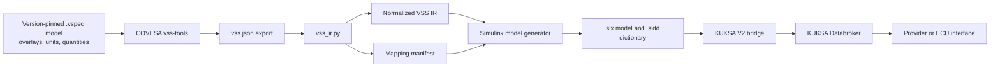

# VSS to Simulink and KUKSA VAL V2 Prototype

## Purpose

This document describes the prototype that:

1. Accepts a version-pinned COVESA VSS model export.
2. Normalizes the exported JSON into a path-based intermediate representation.
3. Creates a mapping manifest for downstream MATLAB and KUKSA integrations.
4. Generates a MATLAB R2026b/Simulink model and data dictionary.
5. Reads two VSS signals from KUKSA VAL V2 and sends an optional ABS actuator request.

This is a local development and verification prototype. It is not a vehicle safety system.

## Components

| Component | Location | Purpose |
|---|---|---|
| VSS export | `MATLAB-VSS/vss.json` | Exported expanded VSS JSON used for testing |
| IR generator | `scripts/vss_ir.py` | Normalizes JSON and creates provenance plus mappings |
| IR output | `generated/vss-6.1/vss_ir.json` | Flat path-addressed VSS nodes |
| Mapping output | `generated/vss-6.1/mapping_manifest.json` | Leaf signal mappings |
| V2 bridge | `simulink/kuksa_v2_bridge.py` | Python gRPC read and actuation implementation |
| Simulink System Object | `simulink/KuksaV2System.m` | MATLAB System block implementation |
| Live setup helper | `simulink/configure_kuksa_live.m` | Configures paced continuous model execution |
| Test provider | `simulink/kuksa_test_provider.py` | Publishes synthetic values and handles ABS requests |
| Model | `generated/kuksa-demo-final/kuksa_v2_demo.slx` | Three-signal demonstration model |
| Data dictionary | `generated/kuksa-demo-final/kuksa_v2_demo.sldd` | Typed Simulink signal objects |

## Data Flow



## Example Signals

| VSS path | VSS type | Simulink direction | MATLAB type |
|---|---|---|---|
| `Vehicle.Speed` | sensor | read | `single`, km/h |
| `Vehicle.ADAS.ABS.IsEngaged` | sensor | read | `boolean` |
| `Vehicle.ADAS.ABS.IsEnabled` | actuator | optional write | `boolean` |

The mapping manifest is not itself a complete runtime binding. Simulink mappings, data-dictionary mappings, broker permissions, provider ownership, and units must be validated separately.

## Normalize an Export

Run from the repository root:

```bash
python3 scripts/vss_ir.py /path/to/vss.json \
  --output-dir generated/vss-6.1 \
  --vss-version 6.1
```

Use `--no-overlays` only when no overlay was applied. Use repeatable `--overlay` options when overlays were applied, preserving application order.

Example:

```bash
python3 scripts/vss_ir.py /path/to/vss.json \
  --output-dir generated/vss-6.1 \
  --vss-version 6.1 \
  --tools-revision <vss-tools-revision> \
  --source-revision <VSS-revision> \
  --no-overlays
```

The generator creates:

- `vss_ir.json`: every node, full path, and exported metadata.
- `mapping_manifest.json`: one mapping entry for each sensor, actuator, and attribute.

The JSON SHA-256 is recorded in both files. A version label and hash identify the exported artifact, but they do not replace source, overlay, unit, quantity, and tool provenance. Unexpanded instance nodes are rejected.

## Model Artifacts

The generated model contains:

- One MATLAB System block named `KUKSA V2`.
- Four outputs:
  - `Speed km/h`
  - `Speed valid`
  - `ABS engaged`
  - `ABS valid`
- Two inputs:
  - `ABS target`
  - `Send command`
- A linked `kuksa_v2_demo.sldd` data dictionary.

The model uses VSS 6.1 signal definitions where the selected paths exist.

## MATLAB Setup

MATLAB R2026b and Simulink were verified with a Windows 64-bit Python 3.13 environment. A WSL Python installation cannot be loaded by Windows MATLAB.

A maintained Windows Python installation is recommended. For the local test, the following portable environment was used:

```text
C:\temp\vss-kuksa-python-3.13.5\python.exe
```

Configure it in MATLAB before Python is loaded:

```matlab
pyenv('Version', 'C:\temp\vss-kuksa-python-3.13.5\python.exe', ...
      'ExecutionMode', 'OutOfProcess');
```

Install the pinned SDK in the Windows environment:

```bat
python.exe -m pip install -r simulink\requirements.txt
```

The pinned SDK is `kuksa-client==0.6.0`.

## Open the Model

```matlab
root = '\\wsl.localhost\Ubuntu\home\set6kor\Raspberry\VSS\vehicle_signal_specification';
addpath(fullfile(root, 'simulink'));
addpath(fullfile(root, 'generated', 'kuksa-demo-final'));
open_system('kuksa_v2_demo');
```

Set the block to the correct broker port:

```matlab
set_param('kuksa_v2_demo/KUKSA V2', 'Host', '127.0.0.1', ...
          'Port', '55556', 'Timeout', '3');
```

## Start a Local KUKSA Broker

The test broker should load the exported VSS model and bind only to localhost:

```bash
docker run --rm --name vss-simulink-test --network host \
  -v /home/set6kor/Raspberry/VSS/MATLAB-VSS/vss.json:/vss.json:ro \
  ghcr.io/eclipse-kuksa/kuksa-databroker:main \
  --address 127.0.0.1 --port 55556 --insecure \
  --disable-authorization --vss /vss.json
```

Keep this terminal open. This configuration disables authorization and TLS. It is for local testing only and must not be used for a vehicle.

Broker 0.7.2-dev.0 was used for the local verification.

## Start the Synthetic Provider

Run from any WSL directory:

```bash
'/mnt/c/temp/vss-kuksa-python-3.13.5/python.exe' -u \
  "$(wslpath -w /home/set6kor/Raspberry/VSS/vehicle_signal_specification/simulink/kuksa_test_provider.py)" \
  --port 55556
```

The provider:

- Publishes `Vehicle.Speed` once per second with changing synthetic values.
- Publishes `Vehicle.ADAS.ABS.IsEngaged=false`.
- Claims `Vehicle.ADAS.ABS.IsEnabled` as an actuator.
- Handles `Actuate` requests through the V2 provider stream.
- Publishes the received actuator state back as `Vehicle.ADAS.ABS.IsEnabled`.

The provider does not represent a real ABS ECU. It must not run beside a real provider for the same actuator.

## Run Continuous Monitoring

Stop the model if it is already running, then in MATLAB:

```matlab
configure_kuksa_live('kuksa_v2_demo', 55556, false);
set_param('kuksa_v2_demo', 'SimulationCommand', 'start');
```

Live mode:

- Uses the MATLAB block's 0.1-second discrete sample time.
- Enables approximately real-time simulation pacing.
- Reads both sensor values at every model step.
- Runs until explicitly stopped.
- Keeps actuation disabled.
- Resets the send trigger to false.

## Send a Test Actuator Request

The live helper may enable actuation by using `true` as its third argument:

```matlab
configure_kuksa_live('kuksa_v2_demo', 55556, true);
set_param('kuksa_v2_demo', 'SimulationCommand', 'start');
```

Send one rising-edge request:

```matlab
set_param('kuksa_v2_demo/ABS target', 'Value', 'true');
set_param('kuksa_v2_demo/Send command', 'Value', 'true');
```

The provider terminal should print:

```text
Simulated ABS enabled: True
```

Reset the trigger before another request:

```matlab
set_param('kuksa_v2_demo/Send command', 'Value', 'false');
```

To request false:

```matlab
set_param('kuksa_v2_demo/ABS target', 'Value', 'false');
set_param('kuksa_v2_demo/Send command', 'Value', 'true');
```

Then reset the trigger again.

A successful actuation RPC means KUKSA forwarded the request and the test provider acknowledged it. It does not prove that a physical actuator moved.

## Observe Broker Values

### Through MATLAB/Simulink

```matlab
configure_kuksa_live('kuksa_v2_demo', 55556, false);
sim('kuksa_v2_demo', 'StopTime', '0.3');
```

Expected sensor values while the synthetic provider is running include changing speed with valid outputs set to true.

### Through V2 Python API

```bash
'/mnt/c/temp/vss-kuksa-python-3.13.5/python.exe' -c '
import grpc
from kuksa.val.v2 import types_pb2 as t, val_pb2 as v, val_pb2_grpc as g
channel = grpc.insecure_channel("127.0.0.1:55556")
stub = g.VALStub(channel)
response = stub.GetValues(v.GetValuesRequest(signal_ids=[
    t.SignalID(path="Vehicle.Speed"),
    t.SignalID(path="Vehicle.ADAS.ABS.IsEngaged")]), timeout=3)
print(response)
channel.close()
'
```

### Through KUKSA V1 CLI

Port matters. The default CLI port is 55555.

For an interactive broker at port 55556:

```bash
docker run --rm -it --network host \
  ghcr.io/eclipse-kuksa/kuksa-databroker-cli:latest \
  --server http://127.0.0.1:55556 --protocol kuksa.val.v1
```

Then:

```text
get Vehicle.Speed
```

The CLI is a legacy V1 client. It can coexist with the V2 bridge, but V2 and V1 actuation semantics should not be mixed in a production provider implementation.

## KUKSA API Usage

The implementation uses KUKSA VAL V2:

- `GetValues`: reads `Vehicle.Speed` and `Vehicle.ADAS.ABS.IsEngaged`.
- `Actuate`: sends `Vehicle.ADAS.ABS.IsEnabled`.
- `OpenProviderStream`: claims and receives actuator requests.
- `PublishValue`: the test provider writes synthetic sensor and actuator states.

V2 differs from V1: V1 separates current and target values for some APIs, while V2 has a single data value and forwards actuator intent to an actuator provider.

## KUKSA and VSS Validation

Before runtime use:

1. Verify the broker loaded the exact VSS model expected by MATLAB.
2. Verify all three paths exist and have the correct types.
3. Verify the broker is using V2 on the selected port.
4. Verify authorization permits reads and actuation.
5. Verify exactly one provider owns each actuator.
6. Verify units: the Python bridge assumes broker and VSS values use `km/h` for `Vehicle.Speed`.
7. Verify provider lifecycle and reconnection behavior.
8. Add message freshness, timeout, stale-data, and safe-state handling before vehicle use.

## Automated Tests

Run the Python tests from the repository root:

```bash
python3 -m unittest discover -s tests -v
```

The tests cover:

- IR metadata and duplicate JSON keys.
- Manifest and provenance output.
- V2 reads and actuator calls.
- Missing datapoints and invalid value types.
- Actuation disabled by default.
- Remote insecure connections rejected.

MATLAB R2026b verification covered:

- Loading the MATLAB System block.
- Adding the block to a model.
- Creating a data dictionary.
- Creating the `.slx` model.
- Loading and updating the model.
- Reading mock V2 values.
- Reading values from an actual local KUKSA broker.
- Sending an opt-in actuator request to a simulated provider.
- Changing speed values over time.
- Reading back the simulated actuator state.

## Troubleshooting

### A model step reports a Python deadline exceeded error

- Set the block `Host` and `Port` to the correct broker.
- The test broker used port 55556.
- Verify Windows Python can reach the broker:

```powershell
C:\temp\vss-kuksa-python-3.13.5\python.exe -c "import grpc; c=grpc.insecure_channel('127.0.0.1:55556'); grpc.channel_ready_future(c).result(timeout=3); print('connected')"
```

- Increase `Timeout` for a slow connection.
- Confirm the broker is still running.

### `Undefined variable 'signals'` appears after a simulation error

The `signals` variable is only assigned if the `sim` call completes. Fix the broker connection or block configuration first, then rerun `sim`.

### A V1 CLI returns only `[get] OK`

The CLI may be querying port 55555 or a different broker. Start it with `--server http://127.0.0.1:55556` and `--protocol kuksa.val.v1`.

### The broker has no value

A broker starts with unavailable datapoints. Start the synthetic provider or run a physical/provider process that publishes the sensor.

### The speed appears once instead of changing

The model itself polls every 0.1 seconds. A changing speed also requires a continuously publishing provider. The test provider publishes once per second. Do not set a one-shot publishing command and expect continuous updates.

### Actuation reports unavailable or denied

- Enable actuation in the System block.
- Ensure the send input produces one rising edge.
- Confirm the broker loaded `Vehicle.ADAS.ABS.IsEnabled` as an actuator.
- Confirm a provider has claimed that actuator.
- Confirm broker authorization permits it.
- Check that no other provider owns the same actuator.

## Stop the Test Environment

Stop the model from the Simulink Stop button or MATLAB:

```matlab
set_param('kuksa_v2_demo', 'SimulationCommand', 'stop');
```

Stop the synthetic provider with Ctrl+C in its terminal.

Stop the test broker with Ctrl+C or Docker:

```bash
docker stop vss-simulink-test
```

## Scope and Limitations

- It covers only three signals.
- It does not currently generate the full catalog from the IR.
- It does not generate the Simulink model in Python or C++ for all VSS nodes.
- It does not contain a production ECU/KUKSA provider.
- Its broker test is unauthenticated and local only.
- It is synchronous and suitable for simulation, not high-frequency real-time control.
- It does not treat stale or timestamped data as a model-fault state.
- Actuation requires explicit opt-in and separate provider/safety validation.

## Verification Summary

At the time this document was prepared:

- MATLAB R2026b found and compiled the model.
- Simulink loaded and updated the model successfully.
- The model read KUKSA values on port 55556.
- A changing test speed was observed over both V2 and V1 reads.
- An opt-in Simulink actuator request reached the test provider.
- The test provider published the simulated actuator state back to KUKSA.
- Seven focused Python tests passed.
- A real vehicle provider was not tested.
